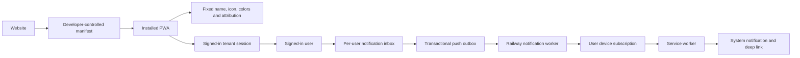

# Placement ERP: PWA and mobile-app implementation prompt chain

> Implementation decision: the installed PWA identity is developer-owned. Its name, icons, description, theme, and developer attribution are configured only in source code or deployment environment variables. College names and logos remain in-app organization profile data and never modify the manifest or installed app. Any earlier white-label steps below are superseded by this rule.

This plan is tailored to the existing Placement ERP repository. It assumes Next.js 16 App Router, React 19, Prisma 7, PostgreSQL, Tailwind 4, Railway hosting, JWT cookies, tenant-scoped database access, RBAC, four portals, existing college `name`/`slug`/`logoUrl` fields, and the current per-user in-app `Notification` records.

Run these prompts **one at a time, in order, in the same coding task**. Review the result and verification from one prompt before sending the next. Do not ask an implementation agent to complete the entire chain in one pass.

## What already exists and must be preserved

- The college is the tenant root, with a unique `slug`, name, and logo.
- College users have JWT sessions containing `userId` and `collegeId`.
- Recruiters use a separate global `CompanyUser` account and session.
- All college data must remain tenant-scoped through `getTenantDb`; any new model with a direct `collegeId` must be added to the allowlist and tested.
- Notifications are already created for individual users on drive, application, offer, interview, event, message, broadcast, and reminder events.
- The notification API already filters by the signed-in user. Push delivery does not exist.
- The mobile layout currently shrinks a desktop sidebar behind a hamburger. It is responsive in places, but it is not yet an app-style mobile shell.
- The current `NotificationBell` expects `type` and `message`, while the database/API returns `eventType`, `title`, and `body`. Correct this during the notification UI phase.
- Production is deployed on Railway and migrations run automatically when the application starts. Every migration must therefore be generated and tested locally before deployment.

## Target architecture



The application uses one developer-controlled installed identity on every college portal. The manifest, icon files, colors, description, and developer attribution are sourced from code or deployment environment variables. College users and administrators have no settings screen or API that can change them. The college name and logo remain visible inside authenticated organization UI only.

The normal website displays an install prompt. Once installed and opened in standalone mode, the prompt is suppressed and the app uses its mobile navigation shell without browser chrome.

Keep the database notification row as the canonical inbox item. Web Push is an additional delivery method, not a replacement. This ensures a user can always open the app and see their history even if notification permission is denied or a device subscription expires.

## Values to decide once

Replace these placeholders before the domain/deployment prompts:

- `{BASE_DOMAIN}`: the first-level wildcard base, for example `placementapp.in`
- `{PLATFORM_NAME}`: the neutral platform name
- `{DEVELOPER_NAME}`: the developer/company attribution
- `{SUPPORT_EMAIL}`: support contact
- `{VAPID_SUBJECT}`: normally a monitored `mailto:` address

## Prompt 0 — baseline and implementation record

```text
Work in the existing Placement ERP repository. Do not deploy, reset the database, discard local changes, or rewrite working modules.

Read README.md, DEPLOYMENT.md, TEST_REPORT.md, package.json, prisma/schema.prisma, app/layout.tsx, app/(dashboard)/layout.tsx, components/dashboard/dashboard-shell.tsx, components/dashboard/sidebar-nav.tsx, components/dashboard/notification-bell.tsx, lib/notify.ts, lib/auth/session.ts, lib/auth/company-session.ts, lib/tenant/scoped-db.ts, and all notification API routes. Inspect the current source rather than assuming the repository matches this prompt.

Run the existing unit tests, lint, type/build checks, and record any pre-existing failures separately. Create PWA_IMPLEMENTATION_STATUS.md with: baseline commands and results, current architecture, current PWA gaps, current notification gaps, mobile UX risks, data/security invariants, and a checklist for Prompts 1–15 below. Do not change product behavior in this step.

Explicitly record that College.slug/name/logoUrl and per-user Notification rows already exist; push subscriptions, a service worker, an install manifest, tenant host resolution, dynamic app metadata, and a native mobile shell do not. Record the NotificationBell field mismatch if it still exists.

Finish with the exact files inspected, results, and any blocker. Do not claim success unless the checks actually ran.
```

## Prompt 1 — resolve colleges from subdomains and enforce the host boundary

```text
Continue the Placement ERP PWA work using PWA_IMPLEMENTATION_STATUS.md. Do not deploy.

Implement a tested tenant-host resolver for `{BASE_DOMAIN}`. Use the Next.js 16 `proxy.ts` convention only for fast host parsing, reserved-host handling, redirects, and forwarding a trusted internal tenant hint. Do not query Prisma in Proxy and do not treat Proxy as the authorization boundary.

Add a server-only resolver that validates the canonical Host/X-Forwarded-Host value against an allowlist, extracts a normalized college slug, rejects unknown or reserved hosts, and loads the College by slug. Support local development explicitly without weakening production validation. Add environment variables for the canonical base domain and reserved hosts.

Enforce the host/tenant match again in authenticated server code. A college session whose collegeId does not match the resolved subdomain must be rejected without exposing another college's name or data. Update the college login route so credentials are accepted only on the user's college subdomain and failures remain generic. Keep cookies host-only; in production use a secure __Host- cookie where compatible. Do not set a parent-domain session cookie.

Design root-domain onboarding safely: users enter or receive their college portal URL. If signup starts on the root domain, use a short-lived, single-use, hashed handoff token to establish the host-only session on the new college subdomain. Never put the session JWT in a URL.

Treat College.slug as a stable origin identifier. Add a reserved-slug rule and a safe migration for existing colleges. Add focused tests for valid hosts, mixed case, ports, forwarded hosts, local development, reserved hosts, unknown colleges, host/session mismatch, and cross-tenant access. Add every new tenant model to lib/tenant/scoped-db.ts.

Run targeted tests, the full test suite, lint, and production build. Update PWA_IMPLEMENTATION_STATUS.md with decisions and evidence.
```

## Prompt 2 — add controlled college branding and asset storage

```text
Continue from the verified tenant-host work. Do not deploy.

Add a controlled white-label branding model for each College. Include an app display name, short name, primary color, accent color, background color, optional light/dark theme colors, and generated branding asset URLs. Use safe defaults derived from the college name and existing logo. Keep the platform name and developer attribution in environment-backed platform configuration; colleges must not be able to impersonate the developer or inject arbitrary footer content.

Create a real Prisma migration and update tenant scoping where required. Validate names and colors server-side. Do not accept arbitrary CSS, HTML, JavaScript, remote asset URLs, or unsanitized SVG. Check color contrast and return understandable validation errors.

Replace database data-URI logo storage for new uploads with an S3-compatible object-storage abstraction suitable for Railway. Keep existing data-URI logos readable during migration. On upload, validate actual file signatures, cap dimensions and bytes, remove metadata, and create normalized PNG/WebP assets plus 192x192, 512x512, maskable, favicon, and monochrome notification-badge variants. Keep original branding changes reversible and delete orphaned assets safely only after a replacement is committed.

Extend the existing College Settings UI behind the correct settings management permission. Show a live header, app icon, light/dark color, and installed-name preview. Make the slug read-only in this release and explain that it is the portal address. Add tests for permissions, cross-tenant writes, upload validation, fallbacks, and asset ownership.

Run migration validation against a local database, tests, lint, and build. Update the status document.
```

## Prompt 3 — dynamic metadata, manifest, icons, and tenant theme

```text
Continue from the branding model. Do not deploy.

Implement tenant-aware page metadata and a dynamic web app manifest resolved from the request host. The installed app on `college-slug.{BASE_DOMAIN}` must use that college's approved app name, short name, icon set, theme color, and background color. Include a stable manifest id, scope `/`, a start URL that reaches the signed-in dashboard, standalone display mode, portrait-primary as a preference rather than a lock where appropriate, categories, and useful role-neutral shortcuts. Add platform-branded metadata for the root and employer hosts.

Expose generated icon endpoints/assets without authentication while resolving them only from a validated host. Return correct content types, ETags, Cache-Control, and Vary headers. Do not leak whether arbitrary college IDs exist. Provide safe platform assets if branding is missing.

Use generateMetadata/server metadata in the App Router so the document title, favicon, apple touch icon, theme color, and social metadata match the host. Apply validated college colors through CSS custom properties at the dashboard boundary, preserving accessible contrast in light and dark modes. Replace hard-coded `Placement ERP` labels in authenticated college chrome with the tenant app name, while keeping developer attribution in About/Settings.

Add tests that request two different hosts and prove their manifests, icons, titles, and theme values cannot cross. Document that installed operating-system metadata may be cached and some branding changes may require the user to reinstall.

Run tests, lint, and build. Update the status document.
```

## Prompt 4 — service worker, install flow, and update lifecycle

```text
Continue from the dynamic manifest. Do not deploy.

Add a small first-party service worker for install lifecycle, push events, notification clicks, badge updates, and a safe offline shell. Keep it independent of the application bundle and serve it at `/sw.js` with JavaScript content type and no-cache/no-store headers. Do not precache authenticated HTML, API responses, student records, resumes, messages, reports, or other tenant data. Cache only versioned static assets, public tenant icons, and a generic offline page. Use network-only for auth and API routes.

Register the worker from a small client component after hydration. Build an app-install control in the user menu/settings. Use `beforeinstallprompt` only when available. For iPhone/iPad, show accurate Add to Home Screen instructions and explain that push becomes available only for an installed Home Screen app on supported iOS versions. Never show the browser permission prompt on page load.

Implement a controlled worker update flow. Detect a waiting worker, show a non-blocking `Update available` action, activate it only after user intent, then reload safely. Avoid automatic reload while a form is dirty. Handle first install, update, offline, restored connection, and unsupported-browser states without errors.

Add service-worker security headers in next.config.ts, CSP compatibility, and tests for route caching rules. Verify installability and update behavior over local HTTPS and production-like HTTPS. Run tests, lint, build, and a Lighthouse PWA check. Update the status document with actual results.
```

## Prompt 5 — create the Android-style responsive application shell

```text
Continue from the installable PWA foundation. Do not deploy and do not change business rules or RBAC.

Redesign the authenticated shell mobile-first so it behaves like an installed Android application. Preserve the desktop sidebar at desktop widths. On phones, replace the sidebar-first interaction with a fixed bottom navigation containing at most five role-specific destinations plus a More sheet. Suggested student tabs: Home, Opportunities, Applications, Messages, Profile. Suggested placement-team tabs: Home, Students, Drives, Messages, More. Determine exact labels from the existing information architecture and permission checks. Never render a destination the user cannot access.

Add a compact sticky top app bar with college icon/name, contextual page title or back action, notification badge, and profile action. Respect `env(safe-area-inset-*)`, use `100dvh`, keep content clear of fixed bars and keyboards, and support standalone display mode. Make primary touch targets at least 44x44 CSS pixels, preserve focus visibility and keyboard navigation, and do not depend on hover.

Use bottom sheets or full-screen mobile dialogs where current desktop dialogs overflow. Keep motion short and purposeful, respect prefers-reduced-motion, and avoid animation libraries unless the existing CSS cannot do the job. Add route-level loading skeletons that preserve final layout and prevent shifts. Provide clear empty, error, offline, and retry states.

Keep shared components rather than cloning a second mobile application. Test navigation and shell behavior at 360x800, 390x844, 412x915, 768x1024, and desktop widths, in light/dark and browser/standalone modes. Run accessibility checks, tests, lint, and build. Update the status document.
```

## Prompt 6 — convert the highest-value workflows for touch and small screens

```text
Continue from the new application shell. Do not deploy.

Audit and improve the highest-frequency mobile workflows without changing their server contracts: student dashboard, opportunities and details, application submission/status, offers, messages, events, profile/resume; placement-team dashboard, students, drives, applications, interviews, offers, broadcasts, and notifications; recruiter dashboard, drive details, and candidate review.

At phone widths, replace wide data tables with semantic cards or compact rows that expose the two or three most important fields and place secondary details/actions in a sheet. Keep real tables for larger screens. Remove fixed widths and two/three-column form grids that cause overflow. Make filters a mobile sheet with an active-filter count and a clear action. Keep destructive and workflow-changing actions explicit and permission-checked.

Preserve scroll position and filter state across back navigation where practical. Use optimistic UI only for reversible operations such as read/unread, bookmarks, and simple preferences; roll back visibly on error. Prevent double submission, show progress within the initiating control, and keep form values after recoverable failures. Use appropriate mobile input types, autocomplete, and keyboard hints.

Fix the messages layout so the conversation list and thread use a mobile list-to-detail pattern rather than a fixed 340px side panel. Verify all critical tasks with touch-only navigation at the target viewport sizes. Add focused regression tests, then run the full tests, lint, and build. Update the status document.
```

## Prompt 7 — build the notification data foundation

```text
Continue from the mobile workflow work. Do not deploy.

Keep Notification as the canonical, per-recipient inbox item. Evolve the schema to support reliable Web Push without duplicating inbox content. Add WEB_PUSH to the delivery/preference channel model and add tenant-scoped PushSubscription, NotificationOutbox, and PushDelivery records (or an equivalently normalized design). A college user may have several devices. Store endpoint, p256dh/auth keys, user agent/device label, VAPID key version, timestamps, active/revoked state, and failure counters. Treat endpoints and keys as secrets: never render them to another user or write them to ordinary logs.

Make outbox creation atomic with Notification creation. Refactor lib/notify.ts so all existing callers still create one inbox row per target user and, when allowed by preference, enqueue push delivery in the same database transaction. Preserve bulk fan-out efficiency and add an optional idempotency/dedupe key. In-app inbox creation should remain available even when push is disabled.

Add event-category defaults for drive updates, applications, interviews, offers, messages, events, broadcasts, and system/security. Define which critical events cannot be disabled in-app and which can be muted for push. Support quiet hours and the user's effective timezone without losing queued items.

Any new model with collegeId must be added to tenant scoping and cross-tenant tests. Use explicit delivery status enums, bounded retry metadata, and timestamps rather than free-form status strings. Generate and test the migration locally. Add unit tests for preference resolution, dedupe, bulk notifications, multiple devices, and transaction rollback. Run tests, lint, and build; update the status document.
```

## Prompt 8 — subscribe the signed-in user safely

```text
Continue from the notification schema. Do not deploy.

Add authenticated, same-origin APIs to create, refresh, list in human-readable form, deactivate, and delete the current user's Web Push subscriptions. The server must derive userId and collegeId from the verified session and resolved host; never accept them from the client. Upsert by endpoint only after proving the subscription belongs to the current origin and current signed-in user. Validate payload size and URL scheme, avoid returning secret keys, and rate-limit mutation/test endpoints.

Add VAPID configuration using NEXT_PUBLIC_VAPID_PUBLIC_KEY, VAPID_PRIVATE_KEY, VAPID_KEY_ID, and `{VAPID_SUBJECT}`. Fail clearly at startup or health checks when push is enabled but configuration is incomplete. Do not commit private keys.

Create an in-app notification settings screen with category-level Web Push toggles, quiet hours, preview privacy, current-device status, and a Send test notification action. Use a two-step permission experience: first explain the value in app UI after the user is signed in, then call Notification.requestPermission only from the user's explicit tap. Handle default, granted, denied, unsupported, iOS-not-installed, expired, and private-browsing states. Provide instructions for re-enabling permission without repeatedly prompting.

On logout or account switch on a shared device, deactivate/unsubscribe the current browser subscription before clearing the session, or use a server-side ownership transfer protocol that cannot send the previous user's private notifications to the next user. Add tests for account switching and cross-tenant subscription attempts.

Run tests, lint, build, and real-browser checks over HTTPS. Update the status document.
```

## Prompt 9 — implement reliable delivery, retries, and custom audience notifications

```text
Continue from subscription management. Do not deploy.

Implement a separate notification worker process for Railway that claims queued outbox rows safely with PostgreSQL locking, sends encrypted Web Push messages with the web-push library, records one delivery result per subscription, and supports more than one worker without duplicate sends. Use bounded exponential backoff with jitter. Mark 404/410 subscriptions inactive, retry only transient failures, cap attempts, and retain a useful redacted failure code. Never log endpoints, auth keys, message bodies, or private student information.

Keep push payloads small. Include notification id, safe title/body or a generic privacy-preserving preview, tenant icon/badge URL, category, tag, timestamp, and a same-origin relative deep link. Validate links on both send and click; never allow arbitrary external URLs. Use collapse/tag behavior only when replacing an older message is semantically correct.

Wire every existing lib/notify.ts caller through the outbox path. Enhance the existing Broadcast workflow instead of creating a competing composer: allow authorized staff to target selected users or approved audiences by role, department, course, batch, placement eligibility, or drive participation; show an exact preview count; exclude users outside the college; require a title/body/deep link; support send-now and scheduled send; and write one auditable inbox item per recipient. Apply RBAC on the server.

Add worker health/lag metrics, queue depth, success/failure counts, and a dead-letter inspection path restricted to platform operations. Add tests for concurrent claimers, idempotency, partial device failure, expired endpoints, retry timing, preference changes, quiet hours, and a 1,000-recipient fan-out. Run tests, lint, build, and a local worker integration test. Update the status document.
```

## Prompt 10 — finish the notification experience in the app and service worker

```text
Continue from reliable delivery. Do not deploy.

Fix and redesign the notification UI around the actual Notification shape: eventType, title, body, link, readAt, and createdAt. Add a full notification center with unread/all filters, category filters, pagination or cursor loading, mark one/all read, and clear/archive behavior that preserves audit expectations. Keep every API scoped to the signed-in recipient.

In the service worker, display system notifications with the tenant icon and monochrome badge. On click, close the notification, focus an existing client for the same origin when possible, navigate it to the validated relative deep link, or open a new window. Post a message to open clients after push receipt so the notification badge and list refresh immediately. Keep visibility-aware polling or refetch-on-focus as a fallback for users without push.

Update the Badging API when supported using the server unread count, and clear/update it when notifications are read. Do not rely on badging for correctness. Avoid showing raw confidential details on a lock screen when the user's preview preference is off.

Add notification actions only for safe operations. Any action that changes an application, interview, or offer must open the authenticated app for confirmation; do not execute sensitive workflow transitions directly from a notification action.

Test multiple signed-in users, multiple devices, foreground/background/closed app, read synchronization, deep links, denied permission, stale sessions, and invalid links. Run tests, lint, build, and real Android plus iOS Home Screen checks. Update the status document.
```

## Prompt 11 — give recruiters a coherent platform PWA

```text
Continue from the college-user notification experience. Do not deploy.

Treat recruiters as global CompanyUser accounts that may work with several colleges. Keep them on the reserved `employers.{BASE_DOMAIN}` origin with a platform/company-branded manifest rather than binding their session to a single college subdomain. Give the recruiter portal the same install, mobile shell, update, offline-status, and subscription quality as the college portal, but keep its cookies, service worker data, and APIs separate.

Design a recruiter notification inbox and push subscriptions associated only with CompanyUser. Do not force CompanyUser into the tenant-scoped User model. Add recruiter events only where the product has a clear recipient and authorization rule, such as a new drive invitation/partnership, candidate application activity for an owned company drive, interview coordination, and an offer response. Include college context in the visible item while verifying the company has an active relationship with that college.

Make company branding secondary to the neutral recruiter platform identity so a recruiter serving multiple colleges does not see the wrong college icon as the installed app identity. Add cross-company and cross-college authorization tests, multiple-partnership tests, and shared-device logout tests.

Run migrations locally, tests, lint, build, and mobile viewport checks. Update the status document.
```

## Prompt 12 — offline behavior, resilience, and perceived speed

```text
Continue from both PWA portals. Do not deploy.

Implement honest offline behavior. The generic app shell and offline page may load, but authenticated tenant data must not be silently cached unless a later feature has an explicit encrypted/offline data design. When the network is unavailable, keep already-rendered data visible, disable server-required actions with an explanation, and provide retry when connectivity returns. Do not queue high-risk workflow changes such as application submission, offer decisions, interview evaluation, role changes, or bulk broadcasts.

Improve perceived speed using App Router loading boundaries, stable skeleton dimensions, Link prefetch where it helps, parallel server queries, and smaller client component boundaries. Audit the dashboard layout for repeated permission/database lookups and resolve permissions once per request. Lazy-load charts, PDF/report generators, complex editors, and rarely used dialogs. Virtualize only genuinely large lists and preserve accessibility.

Instrument Web Vitals and route/action timing without recording personal data. Target p75 LCP <= 2.5s, INP <= 200ms, and CLS <= 0.1 on representative mobile traffic. Establish performance budgets for initial JavaScript, large images, and slow database queries based on the measured baseline. Fix the largest measured bottlenecks rather than adding decorative animation.

Test slow 4G, 4x CPU slowdown, offline/online transitions, expired sessions, worker updates, and form recovery. Run tests, lint, build, and Lighthouse against representative student, staff, and recruiter routes. Record before/after evidence in the status document.
```

## Prompt 13 — security, accessibility, and multi-tenant release tests

```text
Continue from the optimized PWA. Do not deploy.

Perform a release-focused security and accessibility audit, then fix confirmed issues. Verify tenant isolation at the host resolver, session, API, Prisma, object storage, branding assets, manifests, notification inbox, subscriptions, outbox, worker, deep links, and broadcast audiences. Confirm every collegeId model is tenant-scoped and every global recruiter query is constrained by company ownership and partnership.

Add security headers appropriate to the current application and service worker: a tested CSP, frame restrictions, nosniff, referrer policy, permissions policy, HSTS in production, and strict service-worker cache headers. Validate untrusted notification text as text, prevent open redirects, protect secrets, bound request sizes, rate-limit subscription/test/broadcast endpoints, and ensure logs and telemetry contain no credentials, push endpoints, student records, or notification bodies.

Audit keyboard navigation, screen-reader names, focus order/restoration, reduced motion, contrast, zoom/reflow, error association, live regions, and touch target sizes. Test the mobile bottom navigation and sheets without a mouse.

Create an end-to-end matrix with two colleges, at least two users per college, a recruiter with two partnerships, two browser/device subscriptions for one user, and denied push for another. Prove no branding, session, notification, audience, icon, cached response, or deep link crosses boundaries. Run unit, integration, end-to-end, lint, type/build, and Lighthouse checks. Update the status document with exact evidence and unresolved risks.
```

## Prompt 14 — Railway domain and worker deployment runbook

```text
Prepare the production deployment changes for review, but do not deploy.

Update DEPLOYMENT.md and .env.example for `{BASE_DOMAIN}`, wildcard host configuration, reserved hosts, object storage, public/private VAPID values, key version, worker settings, queue batch size, retry policy, and observability. Never add real secrets.

Document the Railway setup for a first-level wildcard custom domain `*.{BASE_DOMAIN}`, its required DNS verification and certificate records, HTTPS verification, and the root/employers hosts. Include a local subdomain/HTTPS testing recipe. Add a separate Railway worker service using the same repository and database with a dedicated start command; the web service must remain responsible for HTTP traffic. Document health checks, safe concurrency, graceful shutdown, migration ordering, rollback limits, and VAPID key rotation. Keep the existing warning that startup runs `prisma migrate deploy`.

Add a staged release plan: internal tenant, small pilot college, monitored rollout, then general availability. Include tests for install, branding, Android push, iOS Home Screen push, account switching, notification privacy, expired endpoints, worker restart, database failover behavior, and rollback. State which branding changes may require reinstall because the operating system caches manifest metadata.

Run all local checks one final time and provide a review packet listing migrations, environment variables, service changes, domain changes, monitoring, rollback plan, and exact commands. Stop before any Railway, DNS, or production mutation.
```

## Prompt 15 — final integration audit and release candidate

```text
Treat the current repository as a release candidate. Do not deploy.

Read PWA_IMPLEMENTATION_STATUS.md and inspect every change from Prompts 1–14. Remove temporary code, demo-only buttons, duplicate paths, stale comments, and abandoned migrations only when safe. Confirm the implementation matches the repository's actual architecture and not merely the original prompt wording.

Run the complete release suite from a clean application start with a local PostgreSQL database: migrations, seed, unit tests, integration tests, end-to-end tests for two tenants and the recruiter portal, lint, production build, worker integration, Lighthouse PWA/installability, accessibility, mobile viewports, service-worker update, offline fallback, Android-style standalone display, foreground/background push, unread badges, account switching, and cross-tenant negative tests.

Review the final UX as a product: a student should install the college-branded app, sign in, move through the five main tabs without a hamburger, receive only their own relevant notifications, tap one into the correct authenticated screen, and retain an inbox if push is denied. A placement officer should customize safe branding, choose an exact notification audience, preview the count, send once, and see delivery/audit results. A recruiter should use the separate employer app across colleges without inheriting one college's identity.

Update README.md, DEPLOYMENT.md, and PWA_IMPLEMENTATION_STATUS.md to the final truth. Report passing evidence, any known limitation with impact, and the smallest safe follow-up. Produce the release checklist, then stop before deployment.
```

## Product choices that should remain firm

- One codebase and one database remain appropriate; do not split into native Android and iOS apps for this goal.
- The developer controls the installed PWA name, icons, colors, description, and attribution; college settings do not alter them.
- The normal website shows the install prompt, while standalone mode suppresses it.
- A notification always belongs to one authenticated recipient. Audience rules resolve to recipients on the server.
- Push permission is requested only after a signed-in user taps an explanatory control.
- In-app history continues to work when push is unavailable.
- Authenticated business data is not cached offline by default.
- A mobile application shell is shared with desktop components and RBAC rather than copied into a second frontend.
- The recruiter portal remains globally scoped and uses the reserved employer origin.
- Deployment, DNS, production migrations, and VAPID key rotation happen only after the release candidate is reviewed.

## Official references used for the strategy

- Next.js PWA guide: https://nextjs.org/docs/app/guides/progressive-web-apps
- Next.js multi-tenant guide: https://nextjs.org/docs/app/guides/multi-tenant
- Next.js 16 Proxy convention: https://nextjs.org/docs/app/api-reference/file-conventions/proxy
- MDN Push API: https://developer.mozilla.org/en-US/docs/Web/API/Push_API
- Apple Web Push for Home Screen web apps: https://developer.apple.com/documentation/usernotifications/sending-web-push-notifications-in-web-apps-and-browsers
- Web Push permission UX: https://web.dev/articles/push-notifications-permissions-ux
- Web app manifest guidance: https://web.dev/learn/pwa/web-app-manifest
- Railway wildcard domains: https://docs.railway.com/networking/domains/working-with-domains
- Core Web Vitals responsiveness guidance: https://web.dev/articles/optimize-inp
- WCAG target size guidance: https://www.w3.org/WAI/WCAG22/Understanding/target-size-minimum
